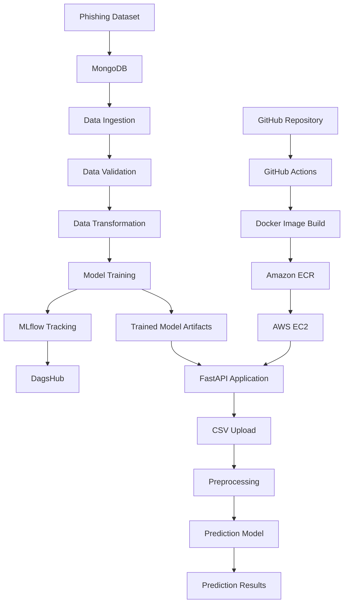

# 🛡️ Network Security — Phishing Detection

An end-to-end Machine Learning project that processes phishing-related data, trains and evaluates ML models, generates batch predictions, and deploys an API using Docker and AWS. The project also integrates MLflow and DagsHub for experiment tracking and GitHub Actions for CI/CD automation.

[](https://www.python.org/)
[](https://fastapi.tiangolo.com/)
[](https://www.docker.com/)
[](https://aws.amazon.com/)
[](https://github.com/features/actions)

## 🚀 Live Deployment

- **Live API documentation:** [Open Swagger UI](http://52.62.4.16:8080/docs)
- **GitHub repository:** [NetworkSecurity](https://github.com/Sarthya-Prakash/networksecurity)
- **MLflow experiments:** [View experiments on DagsHub](https://dagshub.com/Sarthya-Prakash/networksecurity/experiments)

> **Note:** The live API uses an HTTP IP address. Availability depends on the deployed server being online. HTTPS and a custom domain can be configured as future improvements.

## 📌 Project Overview

Network Security is a modular machine learning project designed to process phishing-related datasets and support automated model training and prediction.

The project separates the ML workflow into reusable components for data ingestion, validation, transformation, model training, and prediction. MongoDB supports data storage, while MLflow and DagsHub support experiment tracking.

The application is containerized with Docker and deployed to AWS infrastructure. GitHub Actions automates the build-and-deployment workflow.

## ✨ Key Features

- **Data Ingestion:** Retrieves and prepares data from MongoDB.
- **Data Validation:** Checks incoming data against the configured schema.
- **Data Transformation:** Prepares data for machine learning.
- **Model Training:** Trains and evaluates machine learning models.
- **Batch Prediction:** Processes uploaded CSV files and generates predictions.
- **Experiment Tracking:** Records model parameters, metrics, and training runs with MLflow and DagsHub.
- **Logging and Exception Handling:** Supports debugging and pipeline monitoring.
- **REST API:** Provides application endpoints through FastAPI.
- **Docker Containerization:** Packages the application and its dependencies.
- **CI/CD Automation:** Uses GitHub Actions to build and publish Docker images to Amazon ECR.
- **Cloud Deployment:** Runs the application on AWS EC2.

## 🏗️ System Architecture



## 🔄 Machine Learning Workflow

### 1. Data Ingestion and Validation

- Retrieves data from MongoDB.
- Loads the configured data schema.
- Validates the incoming dataset.
- Passes validated data to the next pipeline stage.

### 2. Data Transformation

- Prepares the input features for model training.
- Applies the configured preprocessing operations.
- Produces data suitable for model development.

### 3. Model Training and Evaluation

- Trains machine learning models using the processed dataset.
- Evaluates candidate models using the configured evaluation metrics.
- Tracks experiments through MLflow and DagsHub.
- Saves the trained model and preprocessing artifacts for inference.

### 4. Batch Prediction

- Accepts a CSV file containing input records.
- Loads the saved preprocessing and model artifacts.
- Applies the required preprocessing.
- Generates predictions and returns the results.

## 🌐 API Endpoints

The FastAPI application provides endpoints for interacting with the project.

| Method | Endpoint | Description |
|---|---|---|
| `GET` | `/` | Redirects to the API documentation. |
| `GET` | `/docs` | Opens the interactive Swagger UI. |
| `GET` | `/train` | Executes the model training pipeline. |
| `POST` | `/predict` | Accepts a CSV upload and returns predictions. |

### Using the Prediction API

1. Open the [API documentation](http://52.62.4.16:8080/docs).
2. Expand the `POST /predict` endpoint.
3. Select **Try it out**.
4. Upload a CSV file containing the expected input features.
5. Execute the request and inspect the prediction output.

**Important:** Use the feature columns expected by the project's preprocessing pipeline. The training endpoint can take time to complete and should only be exposed to trusted users in a production environment.

## 🧪 Experiment Tracking with MLflow and DagsHub

The project integrates MLflow with DagsHub to organize and review machine learning experiments.

Experiment tracking can support:

- Recording model parameters and evaluation metrics.
- Comparing training runs.
- Reviewing precision, recall, F1 score, and other configured metrics.
- Maintaining experiment history.
- Improving reproducibility during model development.

🔗 **[View MLflow Experiments on DagsHub](https://dagshub.com/Sarthya-Prakash/networksecurity/experiments)**

The availability of individual metrics and artifacts depends on what the training pipeline logs during execution.

## ☁️ AWS Deployment and CI/CD

The project uses Docker and AWS services to support deployment automation.

### Deployment Workflow

1. Code changes are pushed to the `main` branch.
2. GitHub Actions checks out the repository and runs the configured CI steps.
3. The workflow builds a Docker image.
4. The image is pushed to Amazon Elastic Container Registry (ECR).
5. A self-hosted GitHub Actions runner on the deployment infrastructure pulls the latest image.
6. The previous application container is replaced with the updated container.
7. Deployment logs and application availability are checked.

### Technologies Used

- **AWS EC2:** Runs the application container.
- **Amazon ECR:** Stores Docker images.
- **Docker:** Packages the application.
- **GitHub Actions:** Automates image building and deployment.
- **Self-hosted runner:** Executes the deployment workflow on the configured infrastructure.

### GitHub Actions Secrets

The workflow requires appropriately configured repository secrets:

| Secret | Purpose |
|---|---|
| `AWS_ACCESS_KEY_ID` | AWS access key for the deployment workflow. |
| `AWS_SECRET_ACCESS_KEY` | AWS secret access key. |
| `AWS_REGION` | AWS region containing the ECR repository. |
| `ECR_REPOSITORY_NAME` | Name of the ECR repository. |
| `DAGSHUB_TOKEN` | Optional, if required by the configured DagsHub authentication method. |

Never commit access keys, database credentials, or authentication tokens to the repository.

## 🧰 Technology Stack

| Category | Technologies |
|---|---|
| Programming Language | Python |
| API Framework | FastAPI |
| Data Processing | Pandas, NumPy |
| Machine Learning | Scikit-learn |
| Database | MongoDB, PyMongo |
| Experiment Tracking | MLflow, DagsHub |
| Configuration | Python-dotenv, YAML |
| Containerization | Docker |
| CI/CD | GitHub Actions |
| Cloud Infrastructure | AWS EC2, Amazon ECR |
| Version Control | Git, GitHub |

## 📂 Project Structure

```text
networksecurity/
├── .github/
│   └── workflow/
├── Network_data/
├── data_schema/
├── final_model/
├── networksecurity/
│   ├── components/
│   ├── entity/
│   ├── exception/
│   ├── logging/
│   └── ...
├── main.py
├── push_data.py
├── test_mongodb.py
├── requirements.txt
├── setup.py
├── Dockerfile
└── README.md
```

The tree above is representative. The exact files and directories may change as the project evolves. The API entry-point filename and workflow directory should match the actual repository.

## ⚙️ Local Setup

### Prerequisites

- Python 3.11 or a compatible project-supported Python version
- Git
- MongoDB connection string
- Required MLflow/DagsHub credentials if experiment tracking is enabled

### 1. Clone the Repository

```bash
git clone https://github.com/Sarthya-Prakash/networksecurity.git
cd networksecurity
```

### 2. Create a Virtual Environment

**Windows:**

```powershell
python -m venv venv
.\venv\Scripts\Activate.ps1
```

**Linux/macOS:**

```bash
python3 -m venv venv
source venv/bin/activate
```

### 3. Install Dependencies

```bash
python -m pip install --upgrade pip
pip install -r requirements.txt
```

### 4. Configure Environment Variables

Create a `.env` file in the project root and add your own MongoDB connection string:

```env
MONGODB_URL_KEY=your_mongodb_connection_string
```

Configure any additional environment variables required by your training and experiment-tracking setup. Keep `.env` out of version control.

### 5. Start the Application

Use the actual API entry-point file and startup command configured in your repository. If the entry point is `app.py` and it starts Uvicorn directly, run:

```bash
python app.py
```

If your entry point or startup command differs, adjust this command accordingly.

Open the local API documentation at:

```text
http://localhost:8000/docs
```

## 🐳 Run with Docker

Build the Docker image from the repository root:

```bash
docker build -t networksecurity:latest .
```

Run the container, mapping host port `8080` to the application's container port `8000`:

```bash
docker run -d \
  --name networksecurity \
  --restart unless-stopped \
  -p 8080:8000 \
  networksecurity:latest
```

Open:

```text
http://localhost:8080/docs
```

This port mapping assumes the application listens on port `8000` inside the container. Adjust it if the Docker configuration uses a different internal port.

## 🔐 Security Considerations

- Store database credentials and cloud keys in environment variables or a secure secrets manager.
- Avoid logging connection strings, access tokens, or other sensitive values.
- Restrict access to the training endpoint.
- Validate uploaded CSV files and handle malformed input safely.
- Use HTTPS and appropriate access controls for a public-facing deployment.
- Configure least-privilege IAM permissions for AWS resources.
- Do not expose sensitive training data or model artifacts publicly.

## 🛣️ Future Improvements

- Add automated unit and integration tests.
- Add stronger input validation and API authentication.
- Configure HTTPS and a custom domain.
- Add automated application health checks and deployment rollback.
- Improve monitoring and structured logging.
- Document model evaluation results using verified experiment metrics.
- Add reproducible training configurations and model-version management.

## 👨‍💻 Author

**Sarthya Prakash**

- **GitHub Profile:** [Sarthya-Prakash](https://github.com/Sarthya-Prakash)
- **Project Repository:** [NetworkSecurity](https://github.com/Sarthya-Prakash/networksecurity)

---

⭐ If you find this project interesting, consider starring the repository.
