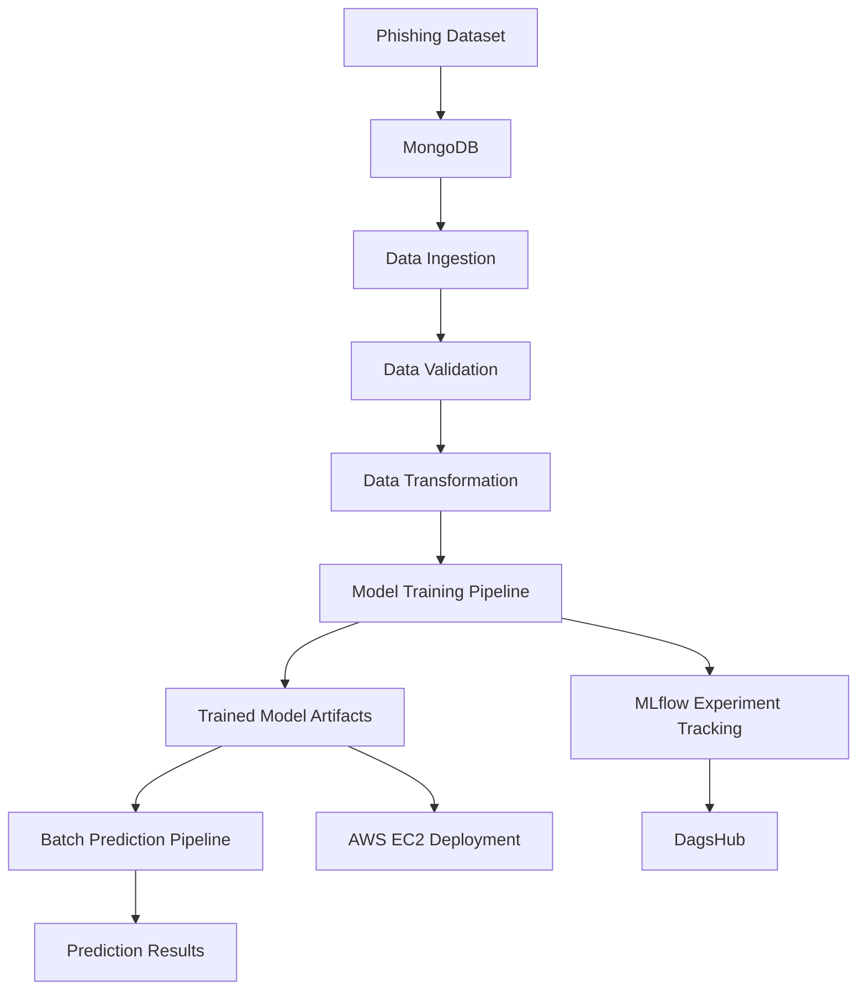

# 🛡️ Network Security — Phishing Detection

An end-to-end Machine Learning project focused on phishing-data analysis, featuring a modular ML pipeline architecture, data processing, model training, batch prediction, and experiment tracking.

## 📌 Overview

Network Security is a machine learning project designed to process phishing-related data through a structured and modular workflow.

The project uses MongoDB for data storage, Python-based pipeline components for data processing, and MLflow with DagsHub for experiment tracking. It follows a modular architecture that separates data ingestion, validation, transformation, model training, and batch prediction.

The project is being developed with AWS EC2 as its target deployment platform.

## ✨ Key Features

- **Data Ingestion:** Retrieves and prepares data from MongoDB.
- **Data Validation:** Validates incoming data against the defined schema.
- **Data Transformation:** Prepares data for machine learning.
- **Model Training Pipeline:** Trains and evaluates machine learning models.
- **Batch Prediction Pipeline:** Generates predictions on batches of new data.
- **Experiment Tracking:** Uses MLflow and DagsHub to track model experiments.
- **Logging and Exception Handling:** Supports debugging and error tracking.
- **Modular Architecture:** Organizes pipeline components into reusable modules.
- **Cloud Deployment:** AWS EC2 deployment as part of the project workflow.

## 🔄 Project Architecture



## ⚙️ Core Pipelines

### 1. Data Ingestion and Validation Pipeline

Handles data collection and preparation for machine learning.

- Ingests data from MongoDB.
- Validates data using the configured schema.
- Performs the required data checks.
- Passes validated data to the transformation stage.

### 2. Model Training Pipeline

Manages the machine learning model development workflow.

- Processes and transforms input data.
- Trains machine learning models.
- Evaluates model performance using appropriate metrics.
- Tracks experiments using MLflow and DagsHub.
- Saves trained models and associated artifacts.

### 3. Batch Prediction Pipeline

Processes batches of new data to generate predictions using the trained model.

- Accepts batch input data.
- Applies the required preprocessing.
- Loads the trained model and generates predictions.
- Produces prediction results for downstream use.

## 🧪 Experiment Tracking with MLflow & DagsHub

This project integrates **MLflow and DagsHub** for experiment tracking, model evaluation, and experiment management.

🔗 **[View MLflow Experiments on DagsHub](https://dagshub.com/Sarthya-Prakash/networksecurity/experiments)**

The experiment tracking workflow supports:

- 📊 Logging model evaluation metrics such as F1 score, precision, and recall.
- 🔍 Comparing machine learning experiments and training runs.
- ⚙️ Tracking model parameters and performance.
- 📦 Organizing model artifacts.
- 🔄 Improving reproducibility by maintaining experiment history.

## 🧰 Tech Stack

| Category | Technologies |
|---|---|
| Programming Language | Python |
| Data Processing | Pandas, NumPy |
| Machine Learning | Scikit-learn |
| Database | MongoDB, PyMongo |
| Experiment Tracking | MLflow, DagsHub |
| Visualization | Seaborn |
| Configuration | Python-dotenv, YAML |
| Version Control | Git, GitHub |
| Cloud Platform | AWS EC2 |

## 📂 Project Structure

```text
networksecurity/
│
├── .github/
│   └── workflow/
│
├── Network_data/
├── data_schema/
├── final_model/
│
├── networksecurity/
│   ├── components/
│   ├── entity/
│   ├── exception/
│   ├── logging/
│   └── ...
│
├── main.py
├── push_data.py
├── test_mongodb.py
├── requirements.txt
├── setup.py
├── Dockerfile
└── README.md
```

*The project structure evolves as the training and batch prediction components are integrated.*

## 📊 Experiment Tracking

The project integrates MLflow and DagsHub for tracking machine learning experiments.

Experiment tracking supports:

- Recording model parameters and evaluation metrics.
- Comparing model-training runs.
- Maintaining experiment history.
- Organizing model artifacts.

## 👨‍💻 Author

**Sarthya Prakash**

- GitHub: [Sarthya-Prakash](https://github.com/Sarthya-Prakash)
- Repository: [NetworkSecurity](https://github.com/Sarthya-Prakash/networksecurity)

---

⭐ If you find this project interesting, consider starring the repository.
  
